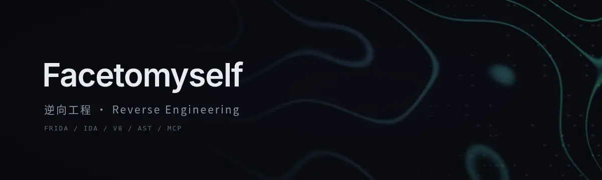

  

Web 与移动端逆向：协议还原、签名算法、反调试与风控。

  <a href="https://github.com/Facetomyself/reverse-engineering-knowledge-base"><b>逆向工程知识库</b></a>
   
  
    <a href="https://github.com/Facetomyself/reverse-engineering-knowledge-base/tree/main/protocols">协议分析</a> ·
    <a href="https://github.com/Facetomyself/reverse-engineering-knowledge-base/tree/main/signature-algorithms">签名算法</a> ·
    <a href="https://github.com/Facetomyself/reverse-engineering-knowledge-base/tree/main/anti-detection">反检测与风控</a> ·
    <a href="https://github.com/Facetomyself/reverse-engineering-knowledge-base/tree/main/packing-bypass">加固与混淆</a> ·
    <a href="https://github.com/Facetomyself/reverse-engineering-knowledge-base/tree/main/native-analysis">Native SO</a> ·
    <a href="https://github.com/Facetomyself/reverse-engineering-knowledge-base/tree/main/web-reverse">Web 逆向</a>
  

 

<table>
<tr><td colspan="2">逆向</td></tr>
<tr><td><a href="https://github.com/Facetomyself/boss-f12-bypass">boss-f12-bypass</a></td><td>DevTools 反调试与风控分析</td></tr>
<tr><td><a href="https://github.com/Facetomyself/ciweimao-api-reverse">ciweimao-api-reverse</a></td><td>Android App 业务协议还原，HMAC / AES 复现</td></tr>
<tr><td><a href="https://github.com/Facetomyself/reverse-deepagent">reverse-deepagent</a></td><td>面向 Web / JS 逆向流程的 Agent 示例</td></tr>
<tr><td colspan="2">MCP</td></tr>
<tr><td><a href="https://github.com/Facetomyself/ruyi-mcp">ruyi-mcp</a></td><td>浏览器自动化、网络检查、指纹分析与 BiDi trace</td></tr>
<tr><td><a href="https://github.com/Facetomyself/wechat-miniapp-re-mcp">wechat-miniapp-re-mcp</a></td><td>微信小程序 / WMPF 逆向调试</td></tr>
<tr><td><a href="https://github.com/Facetomyself/wechat-mp-download-mcp">wechat-mp-download-mcp</a></td><td>公众号历史文章本地下载</td></tr>
</table>

 

<picture>
  <source media="(prefers-color-scheme: dark)" srcset="https://raw.githubusercontent.com/Facetomyself/Facetomyself/output/github-snake-dark.svg" />
  <source media="(prefers-color-scheme: light)" srcset="https://raw.githubusercontent.com/Facetomyself/Facetomyself/output/github-snake.svg" />
  
</picture>
